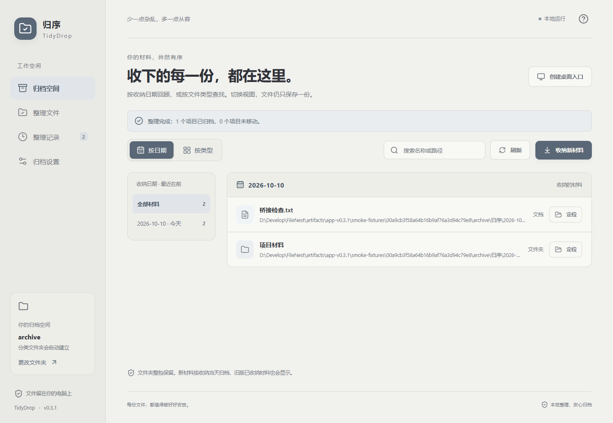
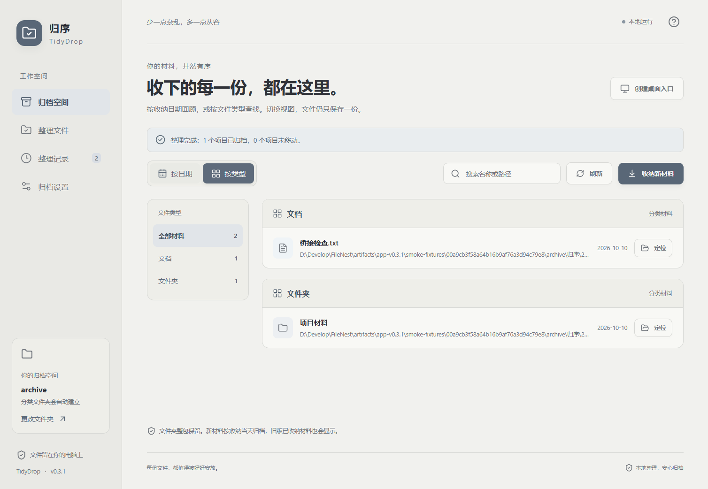

# 归序 · TidyDrop

**拖一下，让文件各归其位。**

归序是一个 Windows 本地收纳工具。选好一个总文件夹，把桌面的文件或文件夹拖到「归序」快捷方式上，后台自动收纳；双击入口，按收纳日期或文件类型查找材料。



## 能做什么

- **桌面后台收纳**：已设置归档位置并开启自动整理时，拖入快捷方式不会打开或抢焦点；完成后后台进程退出。软件已经打开时，新材料发送给现有窗口处理。
- **日期时间线 / 类型卡片**：日期视图按年月和收纳日回顾，类型视图以分类卡片显示材料数量。日期和类型可以组合筛选，切换时左右滑动，并保留筛选和搜索条件；系统开启减少动态效果时直接切换。
- **打开位置**：打开材料实际所在的资源管理器文件夹，并选中它；支持中文、空格和逗号名称。文件夹项目同样打开其所在位置。
- **文件夹整包收纳**：保留子目录、文件和空文件夹，归入「文件夹」分类，不拆散项目结构。
- **一级右键菜单复制路径**：Windows 11 x64 下可在设置中添加「复制文件路径」。支持文件、文件夹与多选，路径不带引号，不用展开「显示更多选项」，不必打开归序。可随时移除。[使用与本地签名说明](docs/context-menu.md)。
- **一份材料，一份存储**：日期与类型是查看同一批材料的两种方式，不会为两个视图重复复制文件。
- **持久化材料清单**：正常启动直接读取已保存的清单；收纳和撤销时更新条目，包含软件关闭时的桌面后台收纳。首次迁移、清单恢复和手动「刷新」时才扫描目录。
- **可预览、可撤销**：关闭自动整理后先预览去向；整理记录保存原位置和目标位置，可以恢复到原处。
- **柔和雾白界面**：TypeScript + React 界面，搭配 C# 文件处理核心，页面与图标全部随程序打包。

## 开始使用

推荐从 **[GitHub Releases](https://github.com/ly20030823/tidydrop/releases)** 下载 `TidyDrop-Setup-版本-win-x64.exe`，适用于 Windows 11 x64。安装包自带 .NET 运行环境，缺少 WebView2 时自动联网安装；可创建桌面入口，选择是否添加一级右键菜单。首次打开后选择归档总文件夹即可使用。当前为个人开发签名，可能出现 Windows 未识别应用提醒；启用右键菜单需要明确授权本机证书信任与管理员确认。详细步骤、升级与卸载见 [安装与 Release 说明](docs/installation-and-release.md)。

也可下载自带运行环境的便携 ZIP，解压整个目录到固定、可写的位置；便携版需要系统已有 WebView2。从源码默认构建的轻量便携程序仍需要 [.NET 9 Desktop Runtime](https://dotnet.microsoft.com/download/dotnet/9.0)。

1. 将**整个程序文件夹**放在固定、可写的位置，打开 `TidyDrop.exe`。
2. 选择归档总文件夹，例如 `D:\我的材料`。
3. 点击「创建桌面入口」。
4. 把文件或文件夹拖到桌面的「归序」图标，后台完成收纳。
5. 双击桌面图标打开「归档空间」，切换「按日期 / 按类型」查看；在「整理记录」中撤销。

也可以在「整理文件」页面拖入材料，或点击「选择文件 / 选择文件夹」。

首次使用尚未选择归档位置，或关闭了「拖入后自动整理」时，桌面拖入会打开界面，供设置或预览。无法收纳的项目会给出提示并保留原位，不会静默丢弃。正常后台收纳不弹出成功窗口，结果可在归档空间和整理记录中查看。

## 目录怎么组织

软件会在你选择的总文件夹中建立自己的 `归序` 子目录，按**本次收纳的本地日期**管理，而不是文件最后修改时间。

```text
我的材料/
└─ 归序/
   └─ 2026-10/
      ├─ 2026-10-10/
      │  ├─ 文档/
      │  │  └─ 项目说明.docx
      │  ├─ 图片/
      │  │  └─ 参考照片.png
      │  └─ 文件夹/
      │     └─ 项目材料/
      │        ├─ 草稿/
      │        └─ 说明.md
      └─ 2026-10-11/
         └─ 文档/
            └─ 会议纪要.pdf
```

按日期视图回答「这一天收纳了什么」：左侧选择收纳日，右侧时间线按天显示材料，可继续筛选文档、图片等类型。按类型视图回答「所有文档在哪里」：选择分类卡片，查看该类材料的列表，并可筛选某个收纳日。筛选后的数量同步更新，切换两种视图保留当前条件；点击「清除筛选」即可回到全部材料。

例如，先选某一天，再选「文档」，就能查看当天收下的文档；切换类型视图后，将收纳日期改为「全部日期」，即可查看跨日期的全部文档。支持搜索名称或路径。文件夹在界面中作为一个项目呈现，内部文件不单独拆出分类。

每份材料旁的「打开位置」会进入它实际所在的文件夹并选中材料，便于打开、复制或继续处理。完整路径可悬停材料名称查看。材料已被移走时会提示点击「刷新」。

支持的类型：文档、图片、视频、音频、压缩包、安装包、设计素材、代码与数据、快捷方式、文件夹、其他。文件分类依据扩展名，不读取文档内容；只建立用到的日期和类型目录。



## 材料清单怎么维护

清单位于归档总文件夹中的 `归序/.tidydrop/catalog.json`，记录材料的相对路径、收纳日期、类型和是否为文件夹。日常启动读取这份文件，日期与类型视图共用清单；收纳和撤销时更新受影响的条目，不扫描其他日期目录。

首次升级时扫描已有归档，建立清单，不搬动材料。以后如果在软件外添加、删除或移动了材料，点击「刷新」即可核对目录、更新清单并刷新下方显示。清单丢失、损坏或更新中断时会从实际目录恢复；损坏的清单先保留备份。清单的临时写入失败不会撤回已经完成的文件移动，会留下恢复标记。

`.tidydrop` 是归序自己的管理目录，不作为材料显示。清单条目按受影响的路径更新，JSON 文件整体原子保存。详细流程、格式和恢复行为见 [存储与材料清单说明](docs/storage-and-catalog.md)。

## 文件保护

- **移动收纳**：成功后源项目从桌面移走。同名目标自动加编号，不覆盖已有文件或文件夹。
- 整理前记录操作意图和 SHA-256 校验值。撤销文件夹时同时校验内部文件内容、相对路径和空目录结构。
- 归档后内容发生变化，或原位置被新项目占用时，停止撤销并保留当前材料。
- 跨盘先复制、校验，再删除已确认的源文件。文件夹删除仅针对已记录文件与空目录，不递归删除新出现的未知文件；异常时保留副本，并记录「未完成」。
- 正在使用、无读取权限、包含链接或云端占位项的材料可能无法收纳。包含归档总文件夹或正在运行程序的文件夹会被拒绝。
- 重复拖入归档空间内的材料保持原位；同时拖入一个文件夹和它的内部文件时，内部文件不重复收纳。
- 意外中断后核对操作记录和真实位置。无法确认的记录标为未完成，需检查原位置和目标位置。
- 撤销恢复材料，不删除软件建立的空日期目录。极少数跨盘失败可能留下 `.tidydrop-*.tmp` 临时副本，请检查记录后再处理。

## 本地数据与升级

文件留在你的电脑上，不上传材料，也不调用 AI 服务。设置和撤销记录保存在程序旁的 `data/`，WebView2 缓存也在该目录；源码仓库与发布包不包含个人设置、操作记录和测试材料。

材料清单跟随归档目录保存，移动程序不影响清单。迁移整个归档总文件夹后，重新选择该位置即可根据相对路径读取材料。`data/history.json` 用于保留原位置与撤销能力，请升级时保留；旧历史中的绝对路径不会因迁移归档目录而自动改写。

从 FileNest v0.1 / v0.2 升级：保留原 `data/`，运行 `TidyDrop.exe`，重新创建「归序」入口。旧版已归档且记录仍存在的材料也会显示，日期采用当时的收纳记录；它们不会被自动搬动。旧版按修改年月分层的设置不再影响新目录。

## 开发与构建

开发环境：.NET 9 SDK、Node.js 24+、pnpm 11、Visual Studio 2022 的 C++ 桌面开发工具与 Windows 11 SDK。微软 WebView2 SDK 使用 `vendor/nuget/` 中的官方包；前端依赖由 `frontend/pnpm-lock.yaml` 固定。

```powershell
git clone https://github.com/ly20030823/tidydrop.git
cd tidydrop
./scripts/build-shell.ps1
./scripts/sign-shell.ps1
./scripts/check-shell.ps1
cd frontend
pnpm install --frozen-lockfile
pnpm build
cd ..
dotnet run --project tests/TidyDrop.Checks/TidyDrop.Checks.csproj -- artifacts/checks
dotnet publish src/TidyDrop.App/TidyDrop.App.csproj -c Release --no-self-contained -o artifacts/app
```

运行 `artifacts/app/TidyDrop.exe`。分发时需要整个输出目录，不能只复制 exe。`scripts/build.ps1` 可以完成菜单组件构建、本地签名、复制路径检查、界面构建、核心检查和发布，并附带第三方许可文件。签名私钥不导出；当前个人开发版安装菜单时需要明确授权本机的本地签名信任，详见 [右键菜单说明](docs/context-menu.md)。

```text
frontend/                  React + TypeScript 界面
src/TidyDrop.Core/          规划、移动、校验、撤销与归档空间
src/TidyDrop.App/           Windows 外壳、桌面快捷方式、后台入口与本地桥接
src/TidyDrop.Shell/         Windows 11 一级右键菜单原生组件与身份包
tests/TidyDrop.Checks/      隔离目录中的文件处理检查
tests/TidyDrop.ShellChecks/ 路径复制、剪贴板与 COM 检查
docs/images/               界面截图（测试材料）
vendor/                    WebView2 SDK 与来源说明
```

## 验证

核心检查覆盖收纳日期、分类、文件与文件夹移动、嵌套及空目录、重名、重叠输入、被占用文件、修改后停止撤销、原位置冲突、记录写入失败、中断恢复、归档空间重建和旧版记录兼容。清单检查另包含不扫描的启动读取、增量收纳与撤销、手动核对、相对路径迁移、损坏备份、越界路径拒绝、写入失败、中断修复及多个写入者之间的同步。

```powershell
# 可选：指定另一块磁盘上的测试目录，增加跨盘文件和文件夹检查
dotnet run --project tests/TidyDrop.Checks/TidyDrop.Checks.csproj -- artifacts/checks C:\可写测试目录

# 在屏幕外验证 React 与原生功能联动，使用程序目录内隔离的测试材料
.\artifacts\app\TidyDrop.exe --smoke-test

# 本机可选：实际打开资源管理器，核对生成的测试文件与文件夹是否被选中
.\artifacts\app\TidyDrop.exe --smoke-test --check-explorer

# 实际快捷方式检查（只在隔离测试目录中移动生成的测试材料）
.\scripts\check-desktop.ps1 -AppDirectory artifacts/app
```

界面联动检查包含设置保存、预览和整理、文件及文件夹撤销、快捷方式创建与复用、运行中接收桌面拖入、跨日期与月份时间线、组合筛选与数量、切换时保留筛选、平滑切换动画及连续点击、减少动态效果和旧环境兼容、搜索与清除条件、手动更新清单和重新读取已保存清单。可选的资源管理器检查会点击真实按钮，验证中文、空格及逗号名称，生成 `smoke-explorer-checks.txt`。检查生成 `smoke-checks.txt` 和截图后退出。GitHub Actions 自动检查前端构建、核心检查和 Windows 程序发布。

## 当前范围

当前面向 Windows，本地按日期和扩展名整理。文件夹按整包项目管理。尚未提供全文搜索、内容识别、自定义分类或自动监控桌面。

[后续开发记录](docs/development-notes.md) 保存了当前功能、旧界面备份位置、大列表性能测试和未来优化方向。性能优化暂缓，待实际使用中遇到卡顿再继续。
